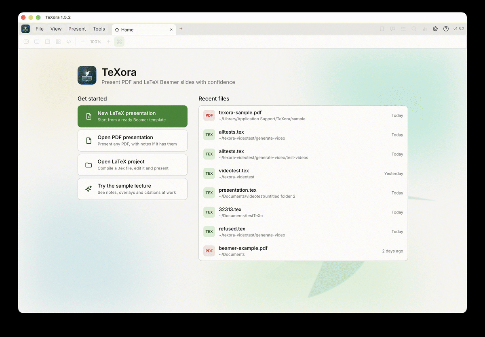
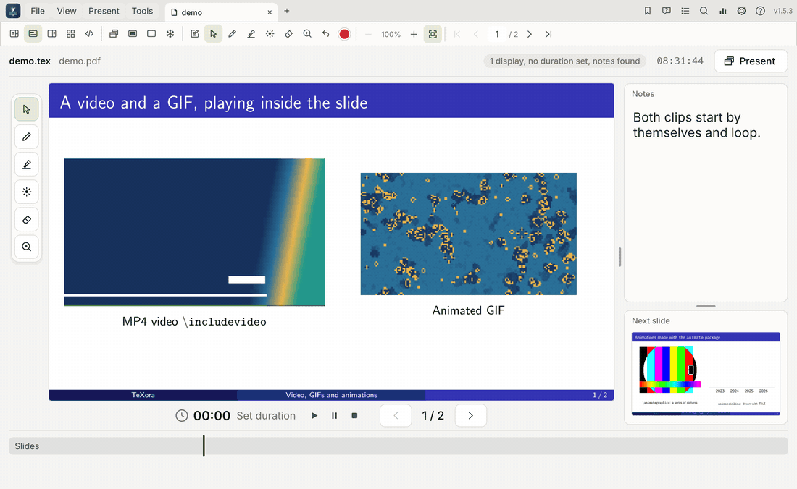

<p align="center">
  
</p>

<h1 align="center">TeXora</h1>

<p align="center">
  <a href="README.en.md"><b>English</b></a> ·
  为 <span> L<sup>A</sup>T<sub>E</sub>X </span> Beamer 和 PDF 幻灯片做的演讲软件：<br>
  私密备注、观众窗口、内置 LaTeX 编辑器、排练数据分析、动画与视频。<br>
  支持 macOS、Windows 和 Linux。
</p>

<p align="center">
  <a href="https://github.com/BluesilveEmperor/TexOra--SS/releases/latest"><b>下载</b></a> ·
  <a href="#features">功能</a> ·
  <a href="#quick-start">快速上手</a> ·
  <a href="#guide">指南</a> ·
  <a href="#keyboard-shortcuts">快捷键</a> ·
  <a href="#building-from-source">自行构建</a>
</p>

> **本仓库是一个独立维护的 fork。** TeXora 由
> [Khalid Alkhaldi](https://github.com/khalidt/TeXora) 编写；原项目、它的发布和作者都留在
> [khalidt/TeXora](https://github.com/khalidt/TeXora)。本 fork 由
> [BluesilveEmperor](https://github.com/BluesilveEmperor) 维护，发布自己的版本号，从 1.0.0 重新起算。
>
> 本 fork 目前的改动：
>
> - **中文界面。** 整个程序——菜单、侧栏、演讲者视图、LaTeX 工作室、命令行帮助和内置指南——都可以用
>   简体中文阅读。在 **设置 > 语言** 里选择；切换即时生效并被记住。英文仍是源语言，所以英文环境下的一切
>   保持原样。
> - **修复了 Video Guide 模板在 Windows 上无法编译的问题。** TeX 的路径搜索不认识 Windows 给绝对路径加的
>   `\\?\` 前缀，于是 TeXora 自己的 `texoravideo` 宏包找不到。
> - **修复了 PDF 引擎没有放在程序旁边的问题。** 新版 cargo 把构建脚本的输出目录写得更深了一层，引擎被拷
>   错了地方，打出来的包打不开 PDF。

<p align="center">
  
  
</p>

TeXora 让演讲者看到备注、当前和下一张幻灯片以及时间，而观众只看到幻灯片。它能打开 PDF 文件和 LaTeX
Beamer 源码；`.tex` 文件在打开时会被编译，既可以在内置的 LaTeX 工作室里编辑，也可以在任何别的编辑器里编辑。

<a id="features"></a>

## 功能

|                              |                                                                                                                                 |
| ---------------------------- | ----------------------------------------------------------------------------------------------------------------------------------- |
| **演讲者视图**               | 备注、当前和下一张幻灯片、叠加步骤、已用时间、相对设定时长的进度，以及时钟。另有大幻灯片和分屏视图。 |
| **观众窗口**                 | 在投影仪或第二块屏幕上全屏显示（F5）。支持黑屏、白板和冻结。                                                 |
| **LaTeX 工作室**             | 带代码折叠和块标记的源码编辑器，旁边是幻灯片与备注预览；错误与警告分开列出；支持 SyncTeX 跳转。       |
| **LaTeX Beamer**             | 用 pdfLaTeX、XeLaTeX 或 LuaLaTeX 编译，引擎按 `% !TEX program` 或所用宏包自动选择。在任何编辑器里保存文件都会重新编译。 |
| **所需软件包**               | 列出一个文件需要的全部宏包、主题和程序，并说明缺的那些怎么装。                                            |
| **演讲者备注**               | 来自 Beamer 备注页、`\note{}`、`.pdfpc` 文件或 Markdown 文件；可在应用里用任何语言编辑。                  |
| **动画与视频**               | `animate` 宏包动画、GIF 和视频片段都能在幻灯片内播放（[看效果](#animations)）；视频用你机器上已装的 ffmpeg 或 VLC。 |
| **批注与指示**               | 画笔、荧光笔、橡皮擦、激光笔和区域放大。墨迹按幻灯片分别保存。                                            |
| **导航**                     | 侧栏里有目录、书签、疑问标记和全文搜索。多份演示文稿各有标签页。                                          |
| **数据分析**                 | 记录每次排练中每张幻灯片的用时，并与上一次比较。                                                          |
| **工具**                     | 可改的快捷键、系统检查、命令行工具和更新提示。                                                              |
| **语言**                     | 英文与简体中文，在设置里选择；切换即时生效并被记住。                                                        |

<a id="download-and-install"></a>

## 下载与安装

每个系统在[最新发布](https://github.com/BluesilveEmperor/TexOra--SS/releases/latest)里都有安装包和便携版。

| 系统                                | 安装包                                   | 便携版                                  |
| ----------------------------------- | ---------------------------------------- | --------------------------------------- |
| macOS，Apple 芯片（M1 及以后）      | `TeXora-<version>-mac-arm64.dmg`         | `…-mac-arm64.zip`                     |
| macOS，Intel                        | `TeXora-<version>-mac-x64.dmg`           | `…-mac-x64.zip`                       |
| Windows 10 与 11（x64）             | `TeXora-<version>-windows-x64-setup.exe` | `…-windows-x64.zip`                   |
| Debian、Ubuntu 及其衍生版（x64）    | `texora_<version>_amd64.deb`             | `TeXora-<version>-linux-x64.tar.gz`   |
| Debian、Ubuntu 及其衍生版（arm64）  | `texora_<version>_arm64.deb`             | `TeXora-<version>-linux-arm64.tar.gz` |

（`<version>` 是版本号，当前为 `1.0.0`。）

- **macOS**：打开 `.dmg`，把 **TeXora** 拖进 **应用程序**。macOS 第一次会要求确认，见
  [macOS 首次启动](#first-launch-on-macos)。
- **Windows**：运行安装程序。它按用户安装，不需要管理员权限（也可以为所有用户安装），会为 PDF 和 `.tex`
  文件添加开始菜单项和「打开方式」入口，并可从*已安装的应用*中卸载。Windows 可能会提示发布者未知。
- **Linux**：`sudo apt install ./texora_<version>_amd64.deb`，然后从菜单启动 **TeXora**，或运行 `texora`。
  `.tar.gz` 版可从任意目录用 `./TeXora` 运行。要求 glibc 2.31 或更新（Ubuntu 20.04、Debian 11 及以后）
  和 X11 或 Wayland 桌面环境。

**依赖。** 演示 PDF 文件不需要装任何东西：每个包里都带 PDF 引擎。

| 要做的事                 | 需要安装                                                                                        |
| ------------------------ | ----------------------------------------------------------------------------------------------- |
| 演示 `PDF` 文件          | 无                                                                                              |
| 编译 `.tex` 文件         | 一套 TeX 发行版：**MacTeX**（macOS）、**MiKTeX** 或 TeX Live（Windows）、**TeX Live**（Linux） |
| 播放 MP4 等视频          | **ffmpeg**（在幻灯片内播放，声音由 ffplay 播放）或 **VLC**（在自己的窗口里播放）。可选；GIF 两者都不需要。 |

每个发布文件都列在 `SHA256SUMS.txt` 里并附校验和；`VALIDATION.txt` 记录了每个文件是怎么测的。

<a id="first-launch-on-macos"></a>

### macOS 首次启动

TeXora 用的是 *ad hoc* 签名，而不是 Apple 开发者 ID 签名，所以 macOS 会拦下第一次启动。

<details>
<summary>第一次打开 TeXora 的步骤</summary>
<br>

**macOS 15 Sequoia 及以后**

1. 打开 **TeXora**，在警告里点 **完成**。
2. 打开 **系统设置 > 隐私与安全性**。
3. 在**安全性**一栏里找到 TeXora 那一项，点 **仍要打开**。
4. 用密码或 Touch ID 确认。

**macOS 14 Sonoma 及更早**：在应用程序里右键（按住 Control 点）TeXora，选 **打开**，再点一次 **打开**。

**终端**（任意版本）：去掉下载标记。

```sh
xattr -dr com.apple.quarantine /Applications/TeXora.app
```

只需要做一次。

</details>

<a id="quick-start"></a>

## 快速上手

1. 启动 TeXora。**主页**会列出最近的文件和几种上手方式。
2. 选择 **新建 LaTeX 演示文稿**、**打开 PDF 演示文稿**或**打开 LaTeX 工程**，挑一个最近的文件，或把文件
   拖到窗口上。**试用样例讲座**会打开一份完整的示例演讲。
3. `.tex` 文件在打开时会被编译。在 **LaTeX 工作室**（Cmd/Ctrl+E）里编辑，或在别的编辑器里编辑。
4. 按 **F5** 打开观众窗口，然后用方向键或 **空格**翻页。

每份演示文稿各开一个标签页，各有各的位置、墨迹和计时器。每个按钮悬停都会显示名称和快捷键。

<details>
<summary><b>新建 LaTeX 演示文稿用的模板</b></summary>
<br>

每个模板都是一份带演讲者备注的完整 Beamer 文件。

| 模板                                                              | 内容                                                                              |
| ----------------------------------------------------------------- | --------------------------------------------------------------------------------- |
| 经典绿、午夜、极简白、会议、日出                                    | 静态主题                                                                         |
| 动态实验室                                                        | 用 TikZ 绘制的动画                                                               |
| 翻页书                                                            | GIF 的逐帧画面，以及会生长的图表                                                  |
| 媒体工作室                                                        | 一段视频片段，以及会自行绘制的图表                                                |
| 视频指南                                                          | 逐页讲解 `\includevideo`，附带在幻灯片内播放的视频和 GIF                         |

翻页书、媒体工作室和视频指南会把图片和片段存到新文件旁边的 `media` 文件夹里。

</details>

<a id="guide"></a>

## 指南

### 演讲者视图

左边是演讲者备注，右边是当前幻灯片（观众看到的那张）和下一张幻灯片。底部依次是计时器、幻灯片编号和章节线。

<details>
<summary>演讲者视图的各个区域</summary>
<br>

| 区域               | 内容                                                                                                                                                |
| ------------------ | --------------------------------------------------------------------------------------------------------------------------------------------------- |
| **顶行**           | 打开的文件；准备情况（屏幕数、时长、备注），演示时则显示观众看到的内容；当前时间；**演示**按钮，用来打开观众窗口。            |
| **备注**           | 当前幻灯片的演讲者备注。滚动或捏合可改变文字大小。                                                                                                |
| **当前幻灯片**     | 观众看到的内容。                                                                                                                                  |
| **下一张幻灯片**   | 下一张幻灯片或下一个叠加步骤。                                                                                                                    |
| **计时器**         | 已用时间（点击可暂停或继续）、演讲时长（点击可设置），以及播放、暂停、停止按钮。                                                                  |
| **上一个 / 下一个**| 前进或后退一步，旁边是幻灯片编号和叠加步骤。                                                                                                      |
| **章节**           | 演讲的各个章节，按各自颜色显示，长度随幻灯片数量。黑色竖线标出当前位置，彩带标出书签。点击章节即可跳转。                                        |
| **进度**           | 剩余时间，或领先、落后、超出的时间。落后时会出现一个按钮，可以跳过几张幻灯片把时间追回来。                                                        |

**大幻灯片**视图（**N**）让幻灯片铺满主区域，绘图工具在旁边。拖动分隔线可以调整面板大小；**视图 > 自动
适应所有面板**可恢复默认。

</details>

### 工具栏

第二排按钮作用于当前打开的演示文稿：视图、观众屏幕、备注、批注、缩放与导航。

<details>
<summary>工具栏的全部按钮</summary>
<br>

**视图**

| 按钮                                                                       | 名称             | 作用                             | 快捷键     |
|:--------------------------------------------------------------------------:| ---------------- | -------------------------------- | ---------- |
|      | 演讲者视图       | 备注配当前和下一张幻灯片         |            |
|      | 大幻灯片         | 大幅当前幻灯片，旁边是备注       | N          |
|                | 幻灯片与备注分屏 | 幻灯片和备注并排，旁边是下一张   | S          |
|            | 幻灯片概览       | 所有幻灯片一览，点击即可跳转     | O          |
|      | LaTeX 工作室     | 在幻灯片旁编辑 `.tex` 源码        | Cmd/Ctrl+E |

**观众屏幕**

| 按钮                                                                        | 名称       | 作用                                              | 快捷键 |
|:---------------------------------------------------------------------------:| ---------- | ------------------------------------------------- | ------ |
|          | 观众窗口   | 幻灯片开在自己的窗口，在第二块屏幕上全屏         | F5     |
|                | 黑屏       | 清空观众屏幕，再按一次恢复                        | B      |
|           | 白板       | 一页白纸，可以直接在上面写                        | W      |
|               | 冻结       | 观众停在当前这张，演讲者可以私下往后看            | F      |

**备注**

| 按钮                                                                     | 名称     | 作用                     | 快捷键         |
|:------------------------------------------------------------------------:| -------- | ------------------------ | -------------- |
|     | 编辑备注 | 就地编辑当前幻灯片的备注 | E              |
|     | 保存备注 | 保存改过的备注           | Cmd/Ctrl+Enter |
|       | 取消     | 放弃改动                 | Esc            |

**批注与指示**

| 按钮                                                                        | 名称     | 作用                                         | 快捷键     |
|:---------------------------------------------------------------------------:| -------- | -------------------------------------------- | ---------- |
|               | 指针     | 普通指针，点击翻到下一页                     | V          |
|                   | 画笔     | 在幻灯片上写，观众屏幕上也可见               | D          |
|         | 荧光笔   | 宽而半透明的笔迹                             | H          |
|              | 激光笔   | 一枚明亮的点，带一小段尾迹                   | L          |
|             | 橡皮擦   | 擦掉笔迹经过的地方                           | X          |
|       | 放大区域 | 拖出一个框，把那块放大给所有人看             | Z          |
|             | 撤销墨迹 | 去掉最后一笔                                 | Cmd/Ctrl+Z |
|               | 颜色     | 墨迹颜色；激光笔开着时是激光的颜色           |            |

墨迹跟着各自的幻灯片。**C** 清除当前幻灯片上的墨迹。

**缩放**

| 按钮                                                                | 名称       | 作用                                             | 快捷键 |
|:-------------------------------------------------------------------:| ---------- | ------------------------------------------------ | ------ |
|      | 缩小       | 把幻灯片变小                                    | -      |
|       | 放大       | 放大幻灯片；滚轮或捏合可绕着指针缩放            | +      |
|       | 适应整页   | 显示整张幻灯片                                  | 0      |

**导航**

| 按钮                                                                | 名称       | 作用                     | 快捷键      |
|:-------------------------------------------------------------------:| ---------- | ------------------------ | ----------- |
|       | 第一张     | 回到开头                 | Home        |
|   | 上一个     | 后退一步                 | Left        |
|       | 下一个     | 下一个叠加步骤或幻灯片  | Right, Space |
|      | 最后一张   | 跳到结尾                 | End         |

点 **上一个** 与 **下一个** 之间的幻灯片编号可以直接输入编号。**Shift+Right** 和 **Shift+Left** 整张跳过；
**Backspace** 回到上一个位置。

**右上角**

| 按钮                                                                  | 名称             | 作用                                                   | 快捷键     |
|:---------------------------------------------------------------------:| ---------------- | ------------------------------------------------------ | ---------- |
|       | 书签             | 用章节的颜色标记这张幻灯片                             | M          |
|       | 疑问             | 记下这张幻灯片上有人提的问题，数据分析里会统计         | Q          |
|       | 目录与书签       | 侧栏：章节、书签和疑问                                 | T          |
|         | 搜索             | 在幻灯片和备注中查找文字                               | Cmd/Ctrl+F |
| | 数据分析         | 每张幻灯片花了多少时间                                 | Y          |
|       | 设置             | 文字大小、LaTeX、软件包、视频、备注、更新和快捷键     | Cmd/Ctrl+, |
|           | 帮助             | 文档、系统检查、命令行工具、快捷键、更新、关于         |            |

这些按钮会在左侧打开侧栏；再点同一个按钮或点叉号就关上。

</details>

### 演讲者备注

备注可以来自 Beamer 备注页（`\setbeameroption{show notes on second screen=right}`）、源码里的
`\note{...}`、`.pdfpc` 文件，或演示文稿旁边的 Markdown 备注文件。**编辑备注**（**E**）就地编辑，
**Cmd/Ctrl+Enter** 保存，**Esc** 取消。

<details>
<summary>备注存在哪里、格式和语言</summary>
<br>

| 打开的文件              | 备注保存在                                                                                     |
| ----------------------- | ---------------------------------------------------------------------------------------------- |
| `Lecture.pdf`           | 同目录下的 `Lecture.note.md`                                                                   |
| `Thesis defense.tex`    | `Thesis defense.tex` 里，每帧写作 `\note{...}`（关掉 **同时保存到 .tex 文件** 时则是 `Thesis defense.note.md`） |

- **PDF**：移动或分享时把 `.note.md` 文件和 PDF 放在一起。每张幻灯片对应一个 `## Slide N` 标题；这个
  文件也可以用任何文本编辑器写。旧版本命名为 `Lecture.notes.md` 的文件仍会被读取，并在下次保存时改名。
- **LaTeX**：源码是备注唯一的地方，所以演讲者视图和工作室永远一致。在演讲者视图里保存的备注会写进该帧的
  `\note{...}`，立刻显示，幻灯片随之重新编译。**设置 > 演讲者备注**会显示当前备注存放在哪里。
- **格式**：Markdown 的 `**粗体**`、`*强调*`、`- 列表` 和 `# 标题`；在 `.tex` 文件里它们会变成 `\textbf`、
  `\emph` 和列表。清空全部文字即删除这张幻灯片的备注。
- **语言**：任何语言和 emoji，用系统字体。阿拉伯语和希伯来语在输入和显示时都是从右往左排。备注以 UTF-8
  保存；UTF-16 和更老的编码也能读。

</details>

### 自定义类与主题

任何 Beamer 演示文稿都能用，包括自定义的 Beamer 类和主题。幻灯片由 LaTeX 构建，所以每一种主题、配色、
模板和宏包的表现都与其他编辑器里一样；TeXora 从 Beamer 自己的 `.nav` 文件里读取帧。

<details>
<summary>支持什么，边界在哪</summary>
<br>

- **自己的类或主题文件**：`\documentclass{acmedeck}` 或 `\usetheme{Acme}`，配合演示文稿所在文件夹里的
  `acmedeck.cls` 或 `beamerthemeAcme.sty`。软件包检查会把它们算作已找到。
- **各种帧写法**：`\begin{frame}…\end{frame}`、命令式 `\frame{…}`，以及包在帧外面定义的自定义帧环境——无论
  定义在文件里还是本地的 `.sty`/`.cls` 里，例如
  `\newenvironment{customframe}[1]{\begin{frame}[environment=customframe]{#1}}{\end{frame}}`。
  它们的 `\note{…}`、标题、叠加、折叠和幻灯片到源码的跳转都能用。
- **`\againframe{label}`** 算作独立的一张幻灯片：它显示所重复那一帧的备注，写在它上面的备注也进那一帧。
- **边界**：放在单独文件里（`\input`、`\include`）或由宏生成的帧，无法与源码一一对应。TeXora 照样能演示
  全部内容（幻灯片、叠加、PDF 备注页和 `.note.md` 备注），但不会读取源码里的 `\note{…}`，编辑过的备注会
  存进 `.note.md` 文件，因此不会有备注落到错误的幻灯片上。

</details>

### LaTeX 工作室

**视图 > LaTeX 工作室**（**Cmd/Ctrl+E**）左边是源码，右边是幻灯片和它的备注，底部是编译信息。输入本身不会
保存或触发编译：**编译**（**Cmd/Ctrl+B**）构建幻灯片，**保存**（**Cmd/Ctrl+S**）在打开
**保存时重新编译**时会重新构建。

<details>
<summary>工作室的控件与编辑</summary>
<br>

| 控件                | 作用                                                             |
| ------------------- | ---------------------------------------------------------------- |
| **编译**            | 保存源码并构建幻灯片。**Cmd/Ctrl+B**                            |
| **保存**            | 保存源码；打开 **保存时重新编译** 时会重新构建。**Cmd/Ctrl+S**   |
| **引擎**            | pdfLaTeX、XeLaTeX 或 LuaLaTeX；**自动**按 `% !TEX program` 或所用宏包决定 |
| **检查所需的软件包**| 列出文件需要的全部宏包、主题和程序，以及缺的那些怎么获取         |
| **保存时重新编译**  | 每当文件被保存（在工作室或别的编辑器里）就重新构建             |
| **跟随光标**        | 显示光标所在行对应的幻灯片                                       |
| **自动换行**        | 按编辑器宽度折行显示长行                                         |
| **演示**            | 回到演讲者视图                                                   |

- **折叠**：行号旁的箭头可以折叠一个环境（`\begin{…}` 到 `\end{…}`）、一个章节（到下一个同级标题）、导言区，
  或一个跨多行的 `{…}` 组（比如很长的 `\note`）。折叠的块显示「⋯ N 行」；点箭头或这个标签即可展开，把光标
  移进去也会展开。文件始终保留每一行。
- **块标记**：行号旁的绿色竖条标出光标所在的块，它的第一行和最后一行会高亮。
- **错误与警告**：问题标签页分开统计并先列错误。错误会中断构建，警告不会。行号有错误是红色，有警告是橙色。
- 工作室开着时编辑器保留键盘输入，所以打字不会触发演讲者快捷键。别的输入框（比如搜索）照常接收自己的输入。
- **Cmd/Ctrl+/** 注释或取消注释当前行与选中的行；**Cmd/Ctrl+]** 总是注释，**Cmd/Ctrl+[** 总是取消注释。
- 双击幻灯片预览可跳到它的源码。**<** 和 **>** 按钮在幻灯片之间移动，滚轮缩放。
- 底部面板有**问题**、**软件包**和**完整日志**三个标签页。点某个问题可跳到它所在的行。拖动面板上边缘可
  调整高度。
- 拖动源码与预览之间的分隔线可以调整大小；双击可恢复各占一半。
- 打开时编译失败的文件会在工作室里打开，并列出问题。
- 文件第一次打开时，会留一份未经改动的副本 `<name>.tex.texora-backup`。
- 幻灯片与源码之间的跳转用 SyncTeX，TeX Live、MacTeX 和 MiKTeX 都自带。

</details>

<a id="animations"></a>

### 动画

<p align="center">
  <br>
  <sub>幻灯片内播放的 MP4 视频和 GIF，随后是两个 <code>animate</code> 宏包动画。</sub>
</p>

用 LaTeX `animate` 宏包制作的动画（`animateinline` 或 `\animategraphics`）会在幻灯片上播放。点击可播放或
暂停；在演讲者视图里，动画下方有一条逐帧播放的条。

<details>
<summary>支持的设置，以及用 <code>animate</code> 播放 GIF</summary>
<br>

| 设置          | 行为                                                         |
| ------------- | ------------------------------------------------------------ |
| `autoplay`    | 幻灯片出现时开始播放，离开时停止；否则等一次点击             |
| `loop`        | 结束后从头开始                                               |
| `palindrome`  | 正放一遍再倒放一遍                                           |
| 帧率          | 跟随源码，包括用 `\newframe[rate]` 改帧率                    |

其他 `animate` 选项未经测试。观众看到的帧和演讲者一样。

LaTeX 不能直接引用 `.gif`。可以用 [ffmpeg](https://ffmpeg.org) 把它拆成图片再用 `\animategraphics` 播放，
或者用下面的 `\includevideo`，它不拆也能播 GIF。

```sh
mkdir frames
ffmpeg -i anim.gif frames/f%d.png      # 加上 -vf "fps=10,scale=640:-1" 可以缩小大 GIF
ls frames | wc -l                      # 帧数
```

```latex
\usepackage{animate}
\animategraphics[autoplay,loop,width=0.5\textwidth]{10}{frames/f}{1}{30}   % 30 = 帧数
```

</details>

### 视频

TeXora 自带 LaTeX 宏包 `texoravideo`，编译时会自动找到。GIF 自行播放；MP4 和其他格式通过你电脑上装的
ffmpeg 或 VLC 播放。TeXora 不含任何视频解码器，也不会下载或安装解码器。

```latex
\usepackage{texoravideo}
\hypersetup{hidelinks}
...
\includevideo[width=0.5\textwidth]{clip.mp4}
\includevideo[height=5cm][loop,autoplay]{media/wave.gif}
```

<details>
<summary>选项、播放器、声音与安全</summary>
<br>

**选项。** 第一个可选参数传给 `\includegraphics`。第二个可选：

| 选项                | 效果                                       |
| ------------------- | ------------------------------------------ |
| `autoplay`          | 幻灯片出现时开始播放                       |
| `loop`              | 播放结束从头再来                           |
| `mute`              | 不带声音播放（幻灯片内和 VLC 里都是）      |
| `posterat=<percent>`| 从片段的那个位置取封面（默认：第一帧）     |
| `poster=<image>`    | 用指定图片作封面                           |

**文件。** 视频必须在 `.tex` 文件所在文件夹里，或其内部的文件夹里（写的时候带上文件夹名）：
`{videos/clip.mp4}`。文件名可以有空格和重音字母，但不能有 `%` 或 `#`。编译前，TeXora 会在
`texora-video` 文件夹里为每个视频做一张封面，只在片段变化时更新，这样任何 PDF 阅读器都能显示封面；只有
TeXora 会播放片段。

**播放。** 点击可播放或暂停；切到别的幻灯片会停掉片段，同一张幻灯片的叠加步骤则让它继续播。**设置 > 视频**
用来选播放器（自动、ffmpeg、VLC 或关闭），每一项都有路径输入框和**测试**按钮。ffmpeg 在幻灯片内播放；VLC
在自己的窗口里播放。没有播放器时，封面会显示「这段视频需要你电脑上装有 VLC 或 ffmpeg。」，并给出**获取
VLC**、**获取 ffmpeg**，在 macOS 和 Linux 上还有**复制安装命令**。TeXora 只复制命令，绝不执行它。

**声音。** 用 ffmpeg 时，声音由 ffplay 播放，它是每个 ffmpeg 安装都带的。声音跟着画面一起开始、暂停、循环，
离开幻灯片就停止。画面跟声音自己的时钟走，所以两者保持同步（测试中相差约 5 毫秒以内）。**设置 > 视频 >
播放声音**可以开关声音。GIF 没有声音。只装了 VLC（没有 ffmpeg）时，VLC 在自己的窗口里放声音；**播放声音**
和 `mute` 在那里同样有效。

**问题。** 文件缺失、文件不是视频，或者路径在演示文稿文件夹之外（绝对路径、`..`、指向外部的链接、网络地址），
都会在封面上显示提示，并出现在**问题**里。

**安全。**

- ffmpeg、ffplay 和 VLC 作为独立程序运行，只用参数列表，绝不经过 shell，切幻灯片就结束。
- ffmpeg 和 ffplay 只读本地文件（`-protocol_whitelist file`）且只认真实视频格式，所以伪装成视频的播放列表
  或拼接列表碰不到别的文件，也上不了网。
- VLC 收到的是 `--` 之后的完整路径，且只传内容确实是视频的文件。
- 程序和参数只来自设置。演示文稿、或它文件夹里的任何文件，都无法设置它们。

</details>

<details>
<summary>在外部播放器里打开的片段（<code>\movie</code>、media9）</summary>
<br>

Beamer 的 `\movie`（`multimedia` 宏包）和 media9 的 `\includemedia` 会在演讲者视图里显示一个播放按钮。
点击会用系统的视频播放器打开片段，可以把它拖到投影仪上；有些播放器会从暂停状态开始。

```latex
\usepackage{multimedia}
\movie[width=4cm,height=2.25cm]{\fbox{Play}}{clip.mp4}
```

- media9 的片段若设为 `activate=pageopen`，会在其幻灯片出现、且观众窗口开着时自动打开。
- `\movie` 引用的文件要和演示文稿放在同一文件夹里。media9 内嵌的片段由 TeXora 提取出来。
- `\movie[externalviewer]`、`\href{run:...}` 和 `\href{file:...}` 链接不会被打开。
- 这些片段不在幻灯片内播放；要在幻灯片内播请用 `\includevideo`。

</details>

### 演示

- **F5** 打开观众窗口，在第二块屏幕上全屏；只有一块屏幕时按 **F11** 全屏。
- **B** 清空屏幕，**W** 显示白板，**F** 冻结观众视图。
- 墨迹、激光笔和缩放，用到时就会出现在观众屏幕上。

### 目录、数据分析与设置

- **目录**（**T**）按颜色列出演讲的各个章节，附带书签和疑问；**回到刚才的位置**可以退回上一个位置。
- **数据分析**（**Y**）逐张记录每次排练的用时，与上一次比较，并可导出 CSV。
- **设置**涵盖文字大小、LaTeX 引擎、所需软件包、视频、备注、更新和全部快捷键。
- **设置 > 语言**用来选择界面语言：英文或简体中文。整个界面、内置指南和 `--help` 的说明会同时改变，
  并且被记住。
- **?** 菜单里有**文档**、**系统检查**、**命令行工具**、**快捷键**、**检查更新**和**关于 TeXora**。

<details>
<summary>更新</summary>
<br>

发布新版本时，右下角会自动出现一条提示，带**看看有什么新内容**、**稍后**和**跳过此版本**，**?** 按钮上也会
多一个小圆点。提示框里有适合当前系统的安装包链接和发布页链接；覆盖安装会保留原来的设置。**? > 检查更新**
可以随时手动检查；**设置 > 更新**可以关掉自动检查。每个版本的变化见
[CHANGELOG.md](CHANGELOG.md)。

</details>

<a id="keyboard-shortcuts"></a>

## 键盘快捷键

macOS 上用 **Cmd**，Windows 和 Linux 上用 **Ctrl**。所有快捷键都能在设置里改。在 LaTeX 工作室里编辑时，
单键快捷键暂时不生效。

<details>
<summary>全部默认快捷键</summary>
<br>

| 操作                   | 按键                  | 操作                   | 按键                     |
| ---------------------- | --------------------- | ---------------------- | ------------------------ |
| 下一步 / 上一步        | Right, Space / Left   | 下一张 / 上一张幻灯片 | Shift+Right / Shift+Left |
| 第一张 / 最后一张      | Home / End            | 跳到某张幻灯片        | G                        |
| 观众窗口               | F5                    | 全屏                   | F11                      |
| 黑屏 / 白屏            | B / W                 | 冻结观众视图           | F                        |
| 概览                   | O                     | 分屏视图               | S                        |
| 大幻灯片               | N                     | 返回                   | Backspace                |
| 启动或暂停计时         | P                     | 停止并归零计时         | R                        |
| 设定演讲时长           | U                     | 书签                   | M                        |
| 标记疑问               | Q                     | 目录                   | T                        |
| 搜索                   | Cmd/Ctrl+F            | 数据分析               | Y                        |
| 指针 / 画笔 / 荧光笔   | V / D / H             | 橡皮擦 / 激光笔        | X / L                    |
| 放大区域               | Z                     | 放大 / 缩小 / 适应     | + / - / 0                |
| 撤销墨迹 / 清除墨迹    | Cmd/Ctrl+Z / C        | 编辑备注 / 保存备注    | E / Cmd/Ctrl+Enter       |
| LaTeX 工作室           | Cmd/Ctrl+E            | 编译 LaTeX             | Cmd/Ctrl+B               |
| 保存源码               | Cmd/Ctrl+S            | 检查所需的软件包       | Cmd/Ctrl+K               |
| 切换注释（工作室）     | Cmd/Ctrl+/            | 注释 / 取消注释        | Cmd/Ctrl+] / Cmd/Ctrl+[  |
| 打开文件               | Cmd/Ctrl+O            | 主页                   | Cmd/Ctrl+L               |
| 关闭标签页             | Cmd/Ctrl+W            | 设置                   | Cmd/Ctrl+,               |
| 取消                   | Esc                   |                        |                          |

</details>

## 命令行

```sh
TeXora talk.pdf          # 打开一份演示文稿（PDF 或 .tex）
TeXora --self-test       # 检查这一份拷贝；退出码 0 表示通过
TeXora --help            # 全部选项
```

**? > 命令行工具**会显示已安装副本的路径。

<a id="building-from-source"></a>

## 自行构建

需要 [Rust](https://rustup.rs)（stable 版）。PDF 引擎（PDFium）会在第一次构建时下载。

```sh
git clone https://github.com/BluesilveEmperor/TexOra--SS.git
cd TeXora
cargo build --release
./target/release/TeXora
cargo test
```

<details>
<summary>项目结构</summary>
<br>

| 路径                  | 内容                                                                                                        |
| --------------------- | ----------------------------------------------------------------------------------------------------------- |
| `src/`                | 应用本体，Rust 写成，用 [egui](https://github.com/emilk/egui) 和 [PDFium](https://pdfium.googlesource.com/pdfium/) |
| `assets/`             | 图标、主页背景图、字体、样例讲座、模板，以及 `texoravideo` LaTeX 宏包                                       |
| `scripts/`            | 打包、安装、发布与图标脚本                                                                                    |
| `installer/`          | Windows 安装程序（Inno Setup）                                                                                |
| `.github/workflows/`  | 持续测试与发布工作流                                                                                          |
| `screenshots/`        | 本 README 里用到的图片                                                                                         |

</details>

## 许可

Copyright 2026 Khalid Alkhaldi。依 [PolyForm Noncommercial 1.0.0](LICENSE) 授权：任何非商业目的都可自由使用、
修改和分享，包括个人使用、学习、教学、科研和非营利工作。商业使用需经作者许可。应用图标和主页背景图是作者的
作品，不在许可范围内。第三方库与字体列在 [CREDITS.md](CREDITS.md) 和
[THIRD-PARTY-LICENSES.md](THIRD-PARTY-LICENSES.md) 中。
