<p align="center">
  
</p>

<h1 align="center">TeXora</h1>

<p align="center">
  <b>Present PDF and LaTeX Beamer slides with confidence.</b><br>
  Free for non-commercial use, with its source code open to read, for macOS, Windows and Linux.
</p>

<p align="center">
  <a href="https://github.com/khalidt/TeXora/releases/latest">Download</a> ·
  <a href="#features">Features</a> ·
  <a href="#using-texora">Guide</a> ·
  <a href="#keyboard-shortcuts">Shortcuts</a> ·
  <a href="#building-from-source">Build</a>
</p>

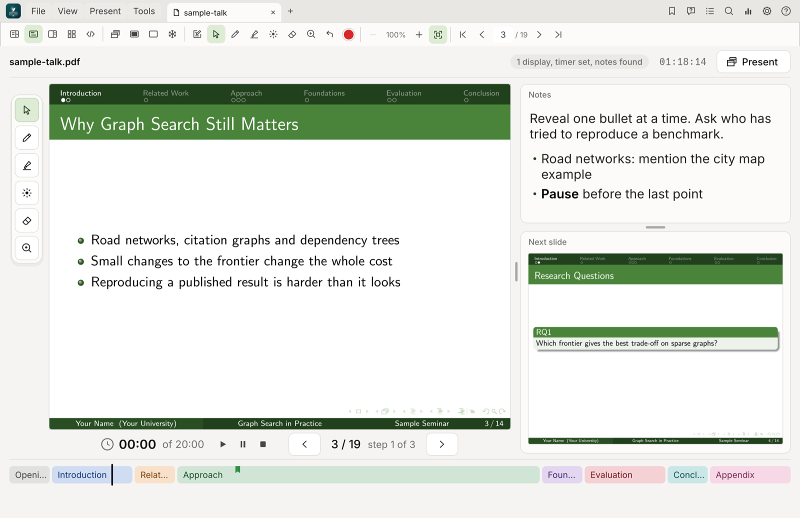

TeXora is a presenter for **LaTeX Beamer** and **PDF** slides. You see your notes, the current and
next slide and the time; the room sees only the slide. Open a `.tex` file and edit it in the built-in
LaTeX studio, beside a live preview, or in your own editor: the slides rebuild either way.

## Screenshots

| Home | Presenter view |
|---|---|
|  |  |

| Slide and notes, side by side | Every slide at a glance |
|---|---|
|  |  |

The audience window shows only the slide, fullscreen on a projector or second screen:


## Features

- **Presenter view**: notes, current and next slide, slide number and overlay step, elapsed time, talk
  duration with pace (ahead or behind), and a clock. Also a large-slide view and a split view.
- **Audience window** (F5): fullscreen on a second display, or press F11 on one display. Black screen
  (B), whiteboard (W) and freeze (F) to look ahead privately.
- **LaTeX studio**: edit the `.tex` source beside a live preview of the slide and its notes. Slides
  rebuild as you type, problems are listed with their line numbers, and a double-click on a slide finds
  its source.
- **LaTeX Beamer**: a `.tex` file compiles with pdfLaTeX, XeLaTeX or LuaLaTeX (chosen for you from
  `% !TEX program` or the packages used). Editing it in your own editor works too: the slides rebuild
  when you save.
- **Required packages**: every package, theme and program your file needs, marked Installed or Needs
  download, with how to get it, in the studio and in Settings.
- **Speaker notes** from PDF notes pages (Beamer's `show notes on second screen`), from `\note{}` in the
  source, from a `.pdfpc` file, or from a Markdown file beside the presentation. **Edit notes** for any
  slide right in the notes panel.
- **Animations and videos**: animations made with the LaTeX `animate` package play on the slide, with
  autoplay, looping and play controls; video clips open in your video player.
- **Drawing and pointing**: pen, highlighter, eraser, a laser pointer in several colours, and zoom into
  an area. Ink is kept per slide.
- **Zoom** any slide with the wheel or a pinch, around the pointer.
- **Bookmarks and questions**: mark slides in their section's colour, and mark where questions came up.
  Only you see them.
- **Contents and search** in a sidebar, from the PDF outline and text.
- **Analytics**: time on each slide for every rehearsal, compared with the last one.
- **Tabs**: several presentations open at once, each keeping its place, ink and timer.
- **Configurable shortcuts**, a **System check** (? menu) that shows what your computer has, a
  **command-line tool**, and **update notices**: TeXora looks for a new release when it starts and every
  few hours while it is open, and tells you in a small notice with a download for your computer.

## Download and install

Get TeXora from the [latest release](https://github.com/khalidt/TeXora/releases/latest).

| System | Installer | Portable |
|---|---|---|
| macOS, Apple chips (M1 and later) | `TeXora-<version>-mac-arm64.dmg` | `…-mac-arm64.zip` |
| macOS, Intel | `TeXora-<version>-mac-x64.dmg` | `…-mac-x64.zip` |
| Windows 10 and 11 (x64) | `TeXora-<version>-windows-x64-setup.exe` | `…-windows-x64.zip` |
| Debian, Ubuntu and relatives (x64) | `texora_<version>_amd64.deb` | `TeXora-<version>-linux-x64.tar.gz` |
| Debian, Ubuntu and relatives (arm64) | `texora_<version>_arm64.deb` | `TeXora-<version>-linux-arm64.tar.gz` |

- **macOS**: open the `.dmg` and drag **TeXora** to **Applications**. The first time, macOS asks you
  to confirm it; see [Opening TeXora on a Mac the first time](#opening-texora-on-a-mac-the-first-time).
- **Windows**: run the setup program. It installs for you alone without administrator rights (or for
  everyone, if you choose), adds TeXora to the Start menu and to "Open with" for PDF and `.tex`
  files, and appears in *Installed apps* for uninstalling. Windows may warn about an unknown publisher.
- **Linux**: `sudo apt install ./texora_<version>_amd64.deb`, then start **TeXora** from the
  menu or run `texora`. Or unpack the `.tar.gz` anywhere and run `./TeXora`. Needs glibc 2.31 or
  newer (Ubuntu 20.04, Debian 11 or later) and an X11 or Wayland desktop.

### Opening TeXora on a Mac the first time

TeXora is signed *ad hoc*, not with a paid Apple Developer ID, so macOS cannot check who made it and
blocks it the first time it is opened.

On **macOS 15 Sequoia and later**, the old right-click > **Open** shortcut no longer works. Instead:

1. Open **TeXora** once and click **Done** on the warning.
2. Go to **System Settings > Privacy & Security**.
3. Scroll to the **Security** section, find the line saying TeXora was blocked, and click **Open Anyway**.
4. Enter your password or use Touch ID, and confirm.

On **macOS 14 Sonoma and earlier**, right-click (or Control-click) TeXora in Applications, choose
**Open**, then **Open** again.

If you prefer Terminal, this removes the download mark so TeXora opens normally:

```sh
xattr -dr com.apple.quarantine /Applications/TeXora.app
```

You only need to do this once; after that TeXora opens like any other app.

Every file is listed with its checksum in `SHA256SUMS.txt`, and `VALIDATION.txt` shows how each one was
tested before the release.

Nothing else is needed to present PDFs: each package carries the program and its PDF engine. To compile
`.tex` files, install a TeX distribution: **MacTeX** on macOS, **MiKTeX** or TeX Live on Windows,
**TeX Live** on Linux.

## Using TeXora

### Getting started

1. Start TeXora. **Home** shows your recent files and ways to begin.
2. Choose **New LaTeX presentation** to start from a template, **Open PDF presentation** or **Open
   LaTeX project**, pick a recent file, or drop a file on the window. **Try the sample lecture** opens
   a ready-made talk to explore.

   **New LaTeX presentation** offers eight templates, each a complete Beamer file with speaker notes:
   Classic Green, Midnight, Minimal White, Conference and Sunrise, and three animated ones. **Motion
   Lab** shows animations drawn with TikZ, **Flipbook** plays the frames of a GIF and charts that
   grow, and **Media Studio** has a video clip and charts that draw themselves. Flipbook and Media
   Studio save their pictures and clip in a `media` folder beside the new file.
3. A `.tex` file is compiled for you. Edit it in the **LaTeX studio** (Cmd/Ctrl+E), or in your own
   LaTeX editor: the slides rebuild either way.
4. Press **F5** to show the slides to the room, then move with the arrow keys or **Space**.

Each presentation opens in its own tab, and keeps its place, ink and timer. Hover over any button to
see its name and shortcut.

### The presenter screen


| Area | What it shows |
|---|---|
| **Top row** | The open files; whether you are ready (displays, duration, notes) or, while presenting, what the audience sees; the time of day; and **Present**, which opens the audience window. |
| **Notes** | Your speaker notes for the slide on screen. Scroll or pinch to change the text size. |
| **Current slide** | What the room sees right now. |
| **Next slide** | What comes next, including the next overlay step. |
| **Timer** | Under the main panel, left of the slide number: time elapsed (click it to pause or resume), the duration (click it to set it), and play, pause and stop buttons. |
| **Previous and next** | Beside the timer: one step back or on, with the slide number and overlay step between them. |
| **Sections** | Your talk's sections in their colours, each as wide as its share of the slides. A black line marks where you are and ribbons mark bookmarks. Click a section to go there. |
| **Pace** | Under the sections: the time left, or how far ahead, behind or over you are. When you are behind, a button offers to skip the next slides that would make up the time. |

In **Large slide** view (**N**) the slide fills the main panel, with the drawing tools beside it and the
notes and next slide on the right:


Drag the dividers between the panels to resize them; **View > Fit all panels automatically** resets them.

### The toolbar

The second row of buttons acts on the open presentation. From left to right:

#### Views

| Button | Name | What it does | Key |
|:---:|---|---|---|
|  | **Presenter** | Notes with the current and next slide. |  |
|  | **Large slide** | A large current slide with the notes beside it. | N |
| 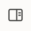 | **Slide and notes split** | The slide and the notes side by side, with the next slide. | S |
| 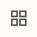 | **Slide overview** | Every slide at a glance. Click one to go there. | O |
| 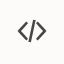 | **LaTeX studio** | Edit the `.tex` source beside the slide. See [The LaTeX studio](#the-latex-studio). | Cmd/Ctrl+E |

#### The room's screen

| Button | Name | What it does | Key |
|:---:|---|---|---|
|  | **Audience window** | Opens the slides in their own window, fullscreen on a projector or second display. | F5 |
| 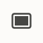 | **Black screen** | Blanks the room's screen. Press again to show the slide. | B |
| 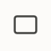 | **Whiteboard** | Shows a white page to draw on. | W |
|  | **Freeze** | Keeps the room on this slide while you look ahead privately. | F |

#### Notes

| Button | Name | What it does | Key |
|:---:|---|---|---|
|  | **Edit notes** | Opens the notes of this slide for editing, in the notes panel. | E |
|  | **Save notes** | Shown while editing. Saves your changes. | Cmd/Ctrl+Enter |
| 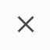 | **Cancel** | Shown while editing. Leaves the notes as they were. | Esc |

#### Drawing and pointing

| Button | Name | What it does | Key |
|:---:|---|---|---|
|  | **Pointer** | The normal pointer: click to move on, no drawing. | V |
| 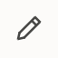 | **Pen** | Draw on the slide. The room sees it too. | D |
|  | **Highlighter** | A wide, see-through stroke to mark text. | H |
|  | **Laser pointer** | A bright dot that follows your pointer, with a short trail. | L |
| 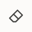 | **Eraser** | Removes the strokes you touch. | X |
|  | **Zoom to area** | Drag a box on the slide to enlarge that part for everyone. | Z |
| 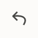 | **Undo ink** | Takes back the last stroke. | Cmd/Ctrl+Z |
|  | **Colour** | Chooses the ink colour, or the laser colour while the laser is on. |  |

Ink is kept with each slide, so it is still there when you come back. **C** clears the ink on the slide.

#### Zoom

| Button | Name | What it does | Key |
|:---:|---|---|---|
|  | **Zoom out** | Makes the slide smaller again. | - |
| 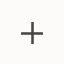 | **Zoom in** | Enlarges the slide. The mouse wheel or a pinch zooms around the pointer. | + |
| 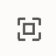 | **Fit to page** | Shows the whole slide again. | 0 |

#### Moving through the slides

| Button | Name | What it does | Key |
|:---:|---|---|---|
| 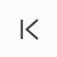 | **First slide** | Goes to the start. | Home |
| 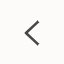 | **Previous** | One step back. | Left |
| 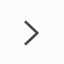 | **Next** | One step on: the next overlay or the next slide. | Right, Space |
| 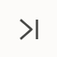 | **Last slide** | Goes to the end. | End |

Between **Previous** and **Next**, the box shows the slide number: click it, type a number and press
Enter. **Shift+Right** and **Shift+Left** skip whole slides, and **Backspace** goes back to where you were.

### The buttons at the top right

| Button | Name | What it does | Key |
|:---:|---|---|---|
| 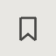 | **Bookmark** | Marks this slide in the colour of its section, to find it again quickly. | M |
|  | **Question** | Marks that someone asked a question on this slide. Analytics counts them. | Q |
|  | **Contents and bookmarks** | Opens the sidebar with sections, bookmarks and questions. | T |
|  | **Search** | Finds a word or phrase in the slides and notes. | Cmd/Ctrl+F |
| 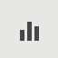 | **Analytics** | Shows how long you spent on each slide. | Y |
|  | **Settings** | Text size, LaTeX engine, required packages, notes, updates and shortcuts. | Cmd/Ctrl+, |
|  | **Help** | Documentation, system check, command-line tool, shortcuts, updates and About. |  |

These open a sidebar on the left. Click the same button again, or the cross, to close it.

### Speaker notes

TeXora shows notes from any of these:

- **Beamer notes pages**: add `\setbeameroption{show notes on second screen=right}` to your preamble.
- **`\note{...}`** in your `.tex` source.
- A **`.pdfpc`** file beside the PDF.
- A **notes file** saved next to the presentation (see below), with a `## Slide N` heading for each
  slide. You can also write it yourself in any text editor.

**Where notes are saved.** It depends on what you opened:

| You opened | Notes are saved in |
|---|---|
| `Lecture.pdf` | `Lecture.note.md`, in the same folder |
| `Week 3 - Graphs.pdf` | `Week 3 - Graphs.note.md`, in the same folder |
| `Thesis defense.tex` | `Thesis defense.tex` itself, as `\note{...}` in each slide (or `Thesis defense.note.md`, with **Also save in the .tex file** unticked) |

For a PDF, keep the `.note.md` file with the presentation when you move or share it, and the notes come
along. Notes saved by earlier versions as `Lecture.notes.md` are still read, and take the new name the
next time you save.

For a LaTeX presentation, the source is the one place its notes live, so the presenter and the LaTeX
studio always show the same notes: a note edited in the presenter is written into that slide's
`\note{...}` and the slides rebuild, and a `\note` edited in the studio (or in your own editor) shows
in the presenter after the rebuild. A note you save in the presenter shows at once, without waiting
for the rebuild. To leave the `.tex` file alone, untick **Also save in the .tex file** under the note
editor (or in **Settings > Speaker notes**); the notes then go into the `.note.md` file beside it. **Settings > Speaker notes** shows where the open presentation's
notes are.

**Edit notes.** Click  or press
**E**, type, then click  or press
**Cmd/Ctrl+Enter** to save; **Esc** cancels. On a slide without notes, **Write notes** in the notes panel
does the same. Your notes are saved where the table above says, so they open with the presentation
next time. Markdown works: `**bold**`, `*emphasis*`, `- lists` and `# headings` (in a `.tex` file they
become `\textbf`, `\emph` and a list). Clearing all the text removes the slide's note.

**Any language.** Notes can be written in any language, including Arabic, Chinese, Japanese and
Korean, and emoji. The fonts come from your computer. Arabic notes are shown right to left, aligned to
the right, both while you type them and when they are shown. Notes are
saved as UTF-8; files saved as UTF-16 or in older encodings are read too.

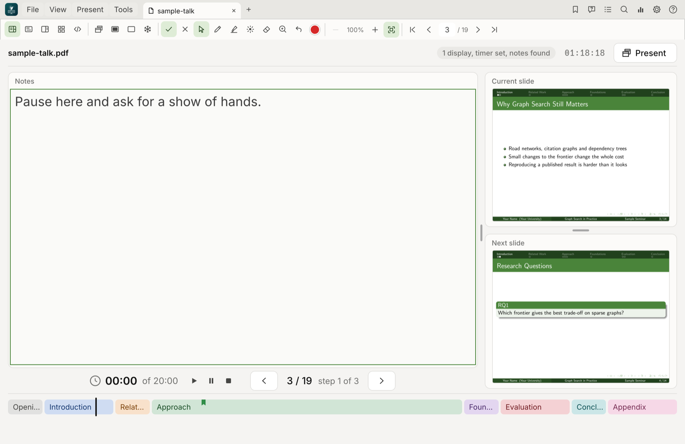

### The LaTeX studio

Open a `.tex` file, then click ,
choose **View > LaTeX studio** or press **Cmd/Ctrl+E**. The source is on the left, the slide and its
notes on the right, and compile messages along the bottom.

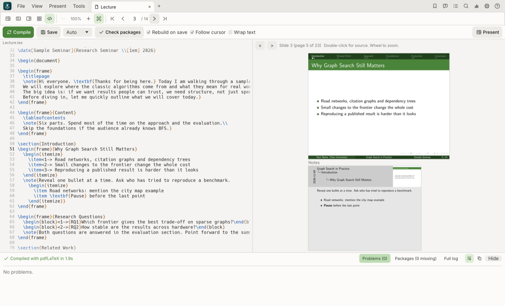

| Control | What it does |
|---|---|
| **Compile** | Saves the source and builds the slides now. Also **Cmd/Ctrl+B**. |
| **Save** | Saves the source, and rebuilds if **Rebuild on save** is on. Also **Cmd/Ctrl+S**. |
| **Engine** (Auto) | pdfLaTeX, XeLaTeX or LuaLaTeX. **Auto** picks from `% !TEX program` or the packages used. |
| **Check packages** | Lists every package, theme and program the file needs, and how to get any that are missing. |
| **Live** | Saves and rebuilds shortly after you stop typing. |
| **Rebuild on save** | Rebuilds each time the file is saved, here or in your own editor. |
| **Follow cursor** | Shows the slide for the line the cursor is on. |
| **Present** | Back to the presenter view. |

- **Comment lines**: **Cmd/Ctrl+/** comments out the line the cursor is on, or every selected line,
  with `%`; if they are all commented already, it uncomments them. **Cmd/Ctrl+]** always comments and
  **Cmd/Ctrl+[** always uncomments. Change these keys in **Settings > Keyboard shortcuts**.
- **Find the source of a slide**: double-click anywhere on the slide preview; the editor jumps to that
  line. The **<** and **>** buttons above the preview move between slides, and the wheel zooms.
- **Problems, Packages, Full log**: the panel along the bottom. Errors show their line number; click
  one to go there. The panel's buttons wrap long lines, copy the text, and hide or show the panel. Drag
  its top edge to resize it.
- If a presentation does not compile when you open it, it opens in the studio with the problems listed.
- Linking slides and source uses SyncTeX, which comes with TeX Live, MacTeX and MiKTeX.

### Animations and videos

**Animations.** Animations made with the LaTeX `animate` package play on the slide:
`\begin{animateinline}...\end{animateinline}`, or `\animategraphics` with a series of pictures (for
example the frames of a GIF). TeXora follows these settings of the animation:

| Setting | What TeXora does |
|---|---|
| `autoplay` | Starts when its slide is shown and stops when you move on. Without it, the animation waits for a click. |
| `loop` | Starts again from the first frame. |
| `palindrome` | Plays forward, then backward. |
| Frame rate | Uses the rate set in the source, including changes with `\newframe[rate]`. |

Other `animate` options have not been tested. Click the animation to play or pause it, in either window.
In the presenter view, a bar under the animation has **first**, **previous**, **play/pause**, **next**
and **last** frame buttons, and shows which frame is on show. The audience sees the same frame.

**Using a GIF.** LaTeX cannot include a `.gif` file directly, so split it into pictures first and play
them with `\animategraphics`. With [ffmpeg](https://ffmpeg.org):

```sh
mkdir frames
ffmpeg -i anim.gif frames/f%d.png
ls frames | wc -l
```

The last command prints the number of frames. Use it as the last number below (30 here):

```latex
\usepackage{graphicx}
\usepackage{animate}
...
\animategraphics[autoplay,loop,width=0.5\textwidth]{10}{frames/f}{1}{30}
```

For a large GIF, shrink it while splitting, for example
`ffmpeg -i anim.gif -vf "fps=10,scale=640:-1" frames/f%d.png`, and keep the `frames` folder beside
the `.tex` file.

**Videos.** Use Beamer's `\movie` (the `multimedia` package) or media9's `\includemedia`. Each shows a
play button in the presenter view. Click it and the video opens in your computer's video player,
which you can move to the projector. The player may start paused, so press play there.

```latex
\usepackage{multimedia}
...
\movie[width=4cm,height=2.25cm]{\fbox{Play}}{clip.mp4}
```

- A clip set to start by itself (`activate=pageopen` in media9) opens when its slide is shown while
  the audience window is open. Otherwise, click it.
- Keep a `\movie` file in the same folder as the presentation. Clips packed into the PDF by media9 are
  unpacked by TeXora.
- Write `\movie` without `externalviewer`. `\movie[externalviewer]` and `\href{run:...}` links are not
  opened yet, and links to local files (`\href{file:...}`) are not opened.
- Videos do not play inside the slide itself.

### Presenting to the room

- **F5** opens the audience window. With a second display it goes fullscreen there; on one display,
  press **F11** to make it fullscreen.
- **B** blanks the screen, **W** shows a whiteboard, and **F** freezes the room on one slide while you
  look ahead.
- Ink, the laser pointer and zoom are shown to the room as you use them.

### Contents, bookmarks and search

The **Contents** sidebar lists the sections of your talk, each in its own colour, with your bookmarks and
questions above them. Click any entry to go there; **Back to where I was** returns.

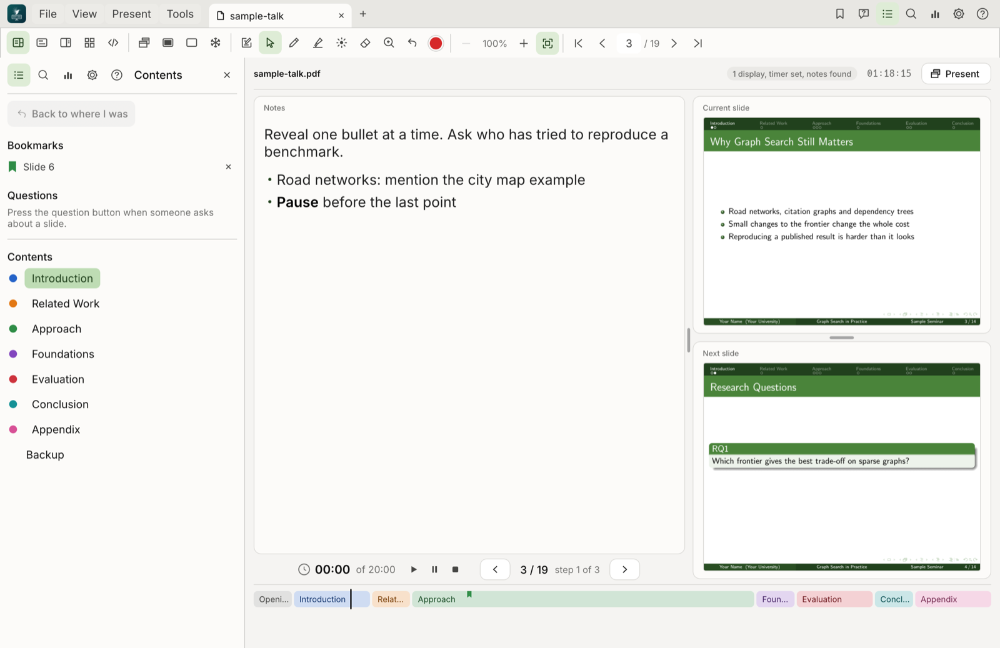

### Analytics

Every rehearsal is timed slide by slide. **Analytics** shows the total time, the time on each slide
compared with your previous run, what stands out, and where questions came up. **Save as CSV** keeps
the numbers.

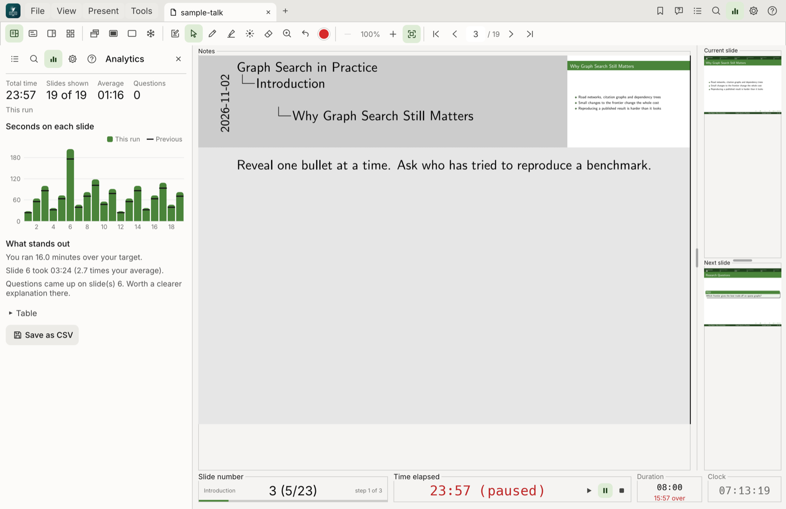

### Settings

**Settings** has sections you can open and close: text size, the LaTeX engine, the packages your file
needs, where your notes are saved, updates, and every keyboard shortcut, which you can change.

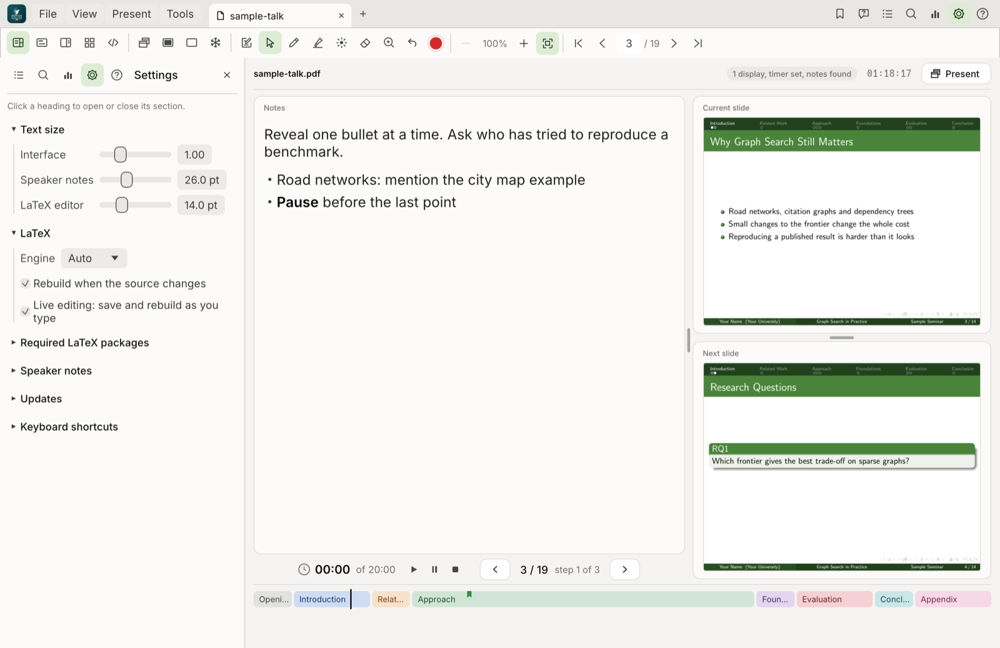

### Help menu

The **?** button holds **Documentation** (a short guide inside the app), **System check** (what this
computer has for TeXora), **Command-line tool** (the path of your copy, with examples), **Keyboard
shortcuts**, **Check for updates** and **About TeXora**.

### Updates

When a new version is published, TeXora shows a notice in the lower right corner by itself, with
**See what's new**, **Later** and **Skip this version**, and a dot on the **?** button. The update box
offers the package for your computer and the release page; install it over your copy and your settings
stay. **? > Check for updates** asks at any time. Turn the automatic look off in **Settings > Updates**.
TeXora 1.0.0 shows the dot on **?** only. See [CHANGELOG.md](CHANGELOG.md) for what changed in each
version.

## Keyboard shortcuts

All can be changed in Settings. On macOS **Cmd** is used; on Windows and Linux, **Ctrl**.

| Action | Keys | Action | Keys |
|---|---|---|---|
| Next / previous step | Right, Space / Left | Next / previous slide | Shift+Right / Shift+Left |
| First / last slide | Home / End | Go to slide | G |
| Audience window | F5 | Fullscreen | F11 |
| Black / white screen | B / W | Freeze audience | F |
| Overview | O | Split view | S |
| LaTeX studio | Cmd/Ctrl+E | Save source | Cmd/Ctrl+S |
| Large slide | N | Back | Backspace |
| Start or pause timer | P | Stop and reset timer | R |
| Set talk duration | U | Bookmark slide | M |
| Mark a question | Q | Contents | T |
| Search | Cmd/Ctrl+F | Analytics | Y |
| Pointer / pen / highlighter | V / D / H | Eraser / laser | X / L |
| Zoom to area | Z | Zoom in / out / fit | + / - / 0 |
| Undo ink / clear ink | Cmd/Ctrl+Z / C | Compile LaTeX | Cmd/Ctrl+B |
| Comment / uncomment lines (studio) | Cmd/Ctrl+/ | Comment / uncomment only | Cmd/Ctrl+] / Cmd/Ctrl+[ |
| Edit notes | E | Save notes | Cmd/Ctrl+Enter |
| Check required packages | Cmd/Ctrl+K | Open file | Cmd/Ctrl+O |
| Home | Cmd/Ctrl+L | Close tab | Cmd/Ctrl+W |
| Settings | Cmd/Ctrl+, | Cancel | Esc |

## Command line

```sh
TeXora talk.pdf                          # open a presentation
TeXora --self-test                       # check this copy works (exit code 0 means it passed)
TeXora --help                            # every option
```

**? > Command-line tool** in the app shows the exact path of your copy.

## Building from source

Needs [Rust](https://rustup.rs) (stable). The PDF engine (PDFium) is downloaded on the first build.

```sh
git clone https://github.com/khalidt/TeXora.git
cd TeXora
cargo build --release
./target/release/TeXora
cargo test
```

## Project layout

| Path | What it holds |
|---|---|
| `src/` | The app, in Rust with [egui](https://github.com/emilk/egui) and [PDFium](https://pdfium.googlesource.com/pdfium/). |
| `assets/` | App icon (`assets/icon.png`), Home picture, fonts and the sample lecture. |
| `scripts/` | Packaging, installer, release and icon scripts. |
| `installer/` | The Windows installer (Inno Setup). |
| `.github/workflows/` | Continuous tests and the release workflow. |
| `screenshots/` | The pictures in this README. |

## Licence

Copyright 2026 Khalid Alkhaldi. Licensed under [PolyForm Noncommercial 1.0.0](LICENSE)
(<https://polyformproject.org/licenses/noncommercial/1.0.0>): free to use, change and share for any
non-commercial purpose, including personal use, study, teaching, research and non-profit work. Commercial
use needs the author's permission. The app icon and Home picture are the author's artwork and are not
covered by the licence. See [CREDITS.md](CREDITS.md) for the libraries and fonts used.

Made by Khalid Alkhaldi.
