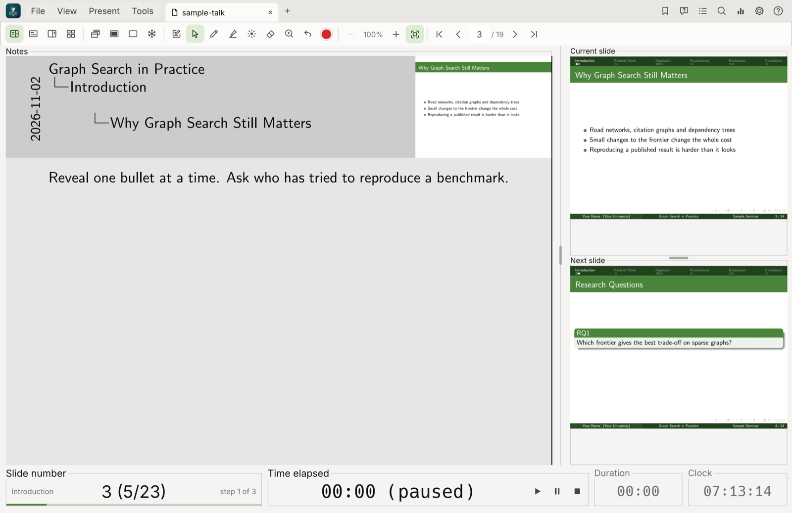
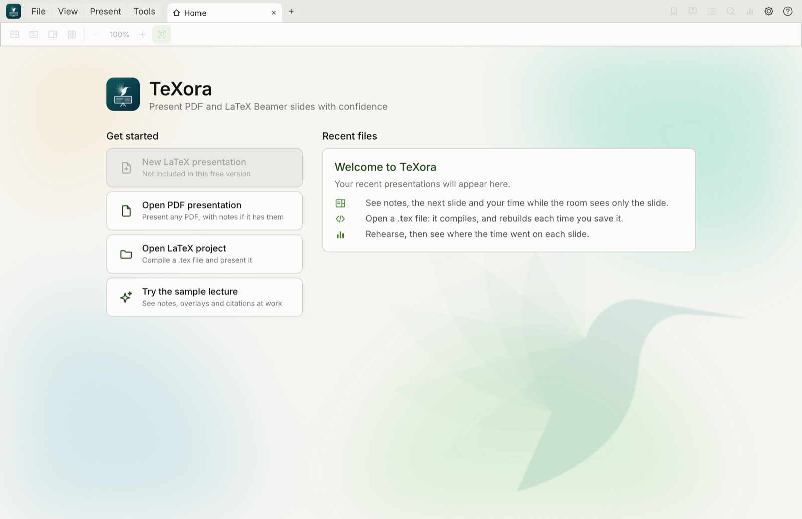
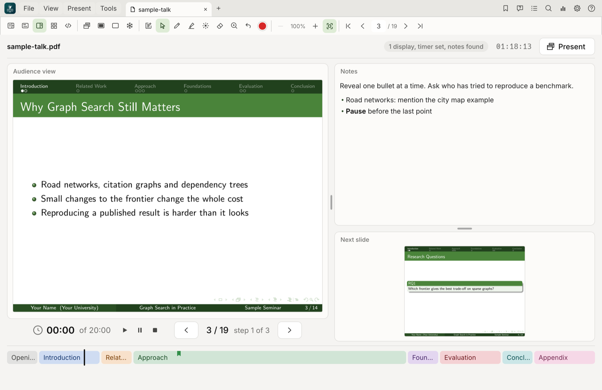
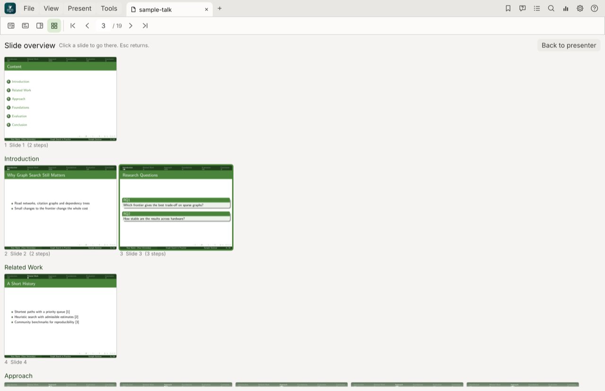
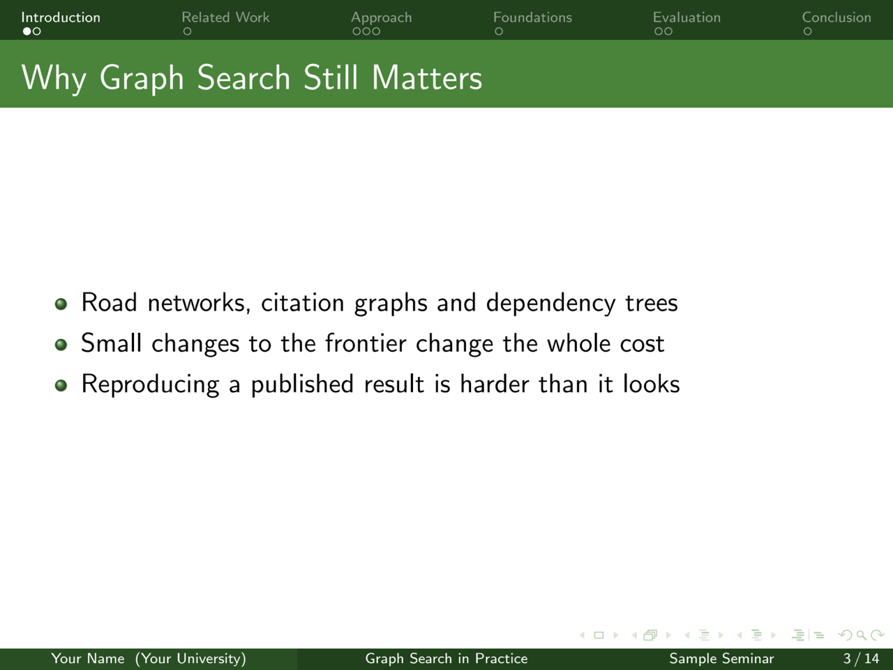

<p align="center">
  
</p>

<h1 align="center">TeXora</h1>

<p align="center">
  <b>Present PDF and LaTeX Beamer slides with confidence.</b><br>
  Free for non-commercial use, with its source code open to read, for macOS, Windows and Linux.
</p>

<p align="center">
  <a href="https://github.com/khalidt/TeXora/releases/latest">Download</a> ·
  <a href="#features">Features</a> ·
  <a href="#keyboard-shortcuts">Shortcuts</a> ·
  <a href="#building-from-source">Build</a>
</p>



TeXora is a presenter for **LaTeX Beamer** and **PDF** slides. You see your notes, the current and
next slide and the time; the room sees only the slide. Open a `.tex` file and TeXora compiles it, then
rebuilds the slides every time you save it in your own editor.

## Screenshots

| Home | Presenter view |
|---|---|
|  |  |

| Slide and notes, side by side | Every slide at a glance |
|---|---|
|  |  |

The audience window shows only the slide, fullscreen on a projector or second screen:



## Features

- **Presenter view**: notes, current and next slide, slide number and overlay step, elapsed time, talk
  duration with pace (ahead or behind), and a clock. Also a large-slide view and a split view.
- **Audience window** (F5): fullscreen on a second display, or press F11 on one display. Black screen
  (B), whiteboard (W) and freeze (F) to look ahead privately.
- **LaTeX Beamer**: open a `.tex` file and it compiles with pdfLaTeX, XeLaTeX or LuaLaTeX (chosen for
  you from `% !TEX program` or the packages used). Edit it in any editor; the slides rebuild when you
  save. Compile errors are shown with their line until fixed.
- **Required packages**: Settings lists every package, theme and program your file needs, marked
  Installed or Needs download, with how to get it.
- **Speaker notes** from PDF notes pages (Beamer's `show notes on second screen`), from `\note{}` in the
  source, from a `.pdfpc` file, or from a Markdown file beside the presentation.
- **Drawing and pointing**: pen, highlighter, eraser, a laser pointer in several colours, and zoom into
  an area. Ink is kept per slide.
- **Zoom** any slide with the wheel or a pinch, around the pointer.
- **Bookmarks and questions**: mark slides in their section's colour, and mark where questions came up.
  Only you see them.
- **Contents and search** in a sidebar, from the PDF outline and text.
- **Analytics**: time on each slide for every rehearsal, compared with the last one.
- **Tabs**: several presentations open at once, each keeping its place, ink and timer.
- **Configurable shortcuts**, a **System check** (? menu) that shows what your computer has, a
  **command-line tool**, and **update notices**: TeXora looks for a new release when it starts and every
  few hours while it is open, and tells you in a small notice with a download for your computer.

## Download and install

Get TeXora from the [latest release](https://github.com/khalidt/TeXora/releases/latest).

| System | Installer | Portable |
|---|---|---|
| macOS, Apple chips (M1 and later) | `TeXora-<version>-mac-arm64.dmg` | `…-mac-arm64.zip` |
| macOS, Intel | `TeXora-<version>-mac-x64.dmg` | `…-mac-x64.zip` |
| Windows 10 and 11 (x64) | `TeXora-<version>-windows-x64-setup.exe` | `…-windows-x64.zip` |
| Debian, Ubuntu and relatives (x64) | `texora_<version>_amd64.deb` | `TeXora-<version>-linux-x64.tar.gz` |
| Debian, Ubuntu and relatives (arm64) | `texora_<version>_arm64.deb` | `TeXora-<version>-linux-arm64.tar.gz` |

- **macOS**: open the `.dmg` and drag **TeXora** to **Applications**. The first time, right-click it
  and choose **Open**, because it is not signed with a paid Apple certificate.
- **Windows**: run the setup program. It installs for you alone without administrator rights (or for
  everyone, if you choose), adds TeXora to the Start menu and to "Open with" for PDF and `.tex`
  files, and appears in *Installed apps* for uninstalling. Windows may warn about an unknown publisher.
- **Linux**: `sudo apt install ./texora_<version>_amd64.deb`, then start **TeXora** from the
  menu or run `texora`. Or unpack the `.tar.gz` anywhere and run `./TeXora`. Needs glibc 2.31 or
  newer (Ubuntu 20.04, Debian 11 or later) and an X11 or Wayland desktop.

Every file is listed with its checksum in `SHA256SUMS.txt`, and `VALIDATION.txt` shows how each one was
tested before the release.

Nothing else is needed to present PDFs: each package carries the program and its PDF engine. To compile
`.tex` files, install a TeX distribution: **MacTeX** on macOS, **MiKTeX** or TeX Live on Windows,
**TeX Live** on Linux.

## Using it

1. Open a PDF or `.tex` file from Home, or drop it on the window. Write your `.tex` file in any LaTeX
   editor; TeXora compiles and presents it.
2. Press **F5** to open the audience window, and move with the arrow keys or Space.
3. Notes: add `\setbeameroption{show notes on second screen=right}` to your Beamer preamble, use
   `\note{...}`, or write `talk.notes.md` beside `talk.pdf` with a `## Slide N` heading per slide.

**? > Documentation** in the app has a short guide.

## Keyboard shortcuts

All can be changed in Settings. On macOS **Cmd** is used; on Windows and Linux, **Ctrl**.

| Action | Keys | Action | Keys |
|---|---|---|---|
| Next / previous step | Right, Space / Left | Next / previous slide | Shift+Right / Shift+Left |
| First / last slide | Home / End | Go to slide | G |
| Audience window | F5 | Fullscreen | F11 |
| Black / white screen | B / W | Freeze audience | F |
| Overview | O | Split view | S |
| Large slide | N | Back | Backspace |
| Start or pause timer | P | Stop and reset timer | R |
| Set talk duration | U | Bookmark slide | M |
| Mark a question | Q | Contents | T |
| Search | Cmd/Ctrl+F | Analytics | Y |
| Pointer / pen / highlighter | V / D / H | Eraser / laser | X / L |
| Zoom to area | Z | Zoom in / out / fit | + / - / 0 |
| Undo ink / clear ink | Cmd/Ctrl+Z / C | Compile LaTeX | Cmd/Ctrl+B |
| Check required packages | Cmd/Ctrl+K | Open file | Cmd/Ctrl+O |
| Home | Cmd/Ctrl+L | Close tab | Cmd/Ctrl+W |
| Settings | Cmd/Ctrl+, | Cancel | Esc |

## Command line

```sh
TeXora talk.pdf                          # open a presentation
TeXora --self-test                       # check this copy works (exit code 0 means it passed)
TeXora --help                            # every option
```

**? > Command-line tool** in the app shows the exact path of your copy.

## Building from source

Needs [Rust](https://rustup.rs) (stable). The PDF engine (PDFium) is downloaded on the first build.

```sh
git clone https://github.com/khalidt/TeXora.git
cd TeXora
cargo build --release
./target/release/TeXora
cargo test
```

## Releases

Releases are built by GitHub Actions, on real macOS, Linux and Windows machines:

- `.github/workflows/ci.yml` builds and tests on all three systems for every change and pull request.
- `.github/workflows/release.yml` runs when a version tag reaches GitHub. It builds the five packages
  and the installers (`.dmg` for both kinds of Mac, a setup program for Windows, `.deb` for Linux x64 and
  arm64), runs every one of them (the Linux ones also with a window on a virtual screen, and each
  installer is installed, run and removed), and only then publishes them all on the Releases page, with
  checksums and a download table.

To make a release:

1. Set `version` in `Cargo.toml`, for example `1.0.1`, and commit.
2. Create the matching tag, `v1.0.1`, and send it to GitHub along with the commit.
3. Watch it under **Actions**. The release appears on the Releases page when every job has passed. If
   the tag does not match `Cargo.toml`, nothing is published.

**Run workflow** on the Release workflow (Actions tab) builds and tests everything without publishing,
and keeps the files as downloadable artifacts of that run. The Linux arm64 build uses GitHub's free
arm64 runners, which need the repository to be public.

On a Mac, `sh scripts/release.sh` builds the same packages, the Mac disk images and the `.deb` files
locally (through Zig and cargo-zigbuild), and runs both Mac packages. The Windows installer is made only
by the workflow, since it needs Windows.

## Project layout

| Path | What it holds |
|---|---|
| `src/` | The app, in Rust with [egui](https://github.com/emilk/egui) and [PDFium](https://pdfium.googlesource.com/pdfium/). |
| `assets/` | App icon (`assets/icon.png`), Home picture, fonts and the sample lecture. |
| `scripts/` | Packaging, installer, release and icon scripts. |
| `installer/` | The Windows installer (Inno Setup). |
| `.github/workflows/` | Continuous tests and the release workflow. |
| `screenshots/` | The pictures in this README. |

## Updates

When a new version is published here, TeXora shows a notice in the lower right corner by itself, with
**See what's new**, **Later** and **Skip this version**, and a dot on the **?** button. The update box
offers the package for your computer and the release page; install it over your copy and your settings
stay. **? > Check for updates** asks at any time. Turn the automatic look off in **Settings > Updates**.
TeXora 1.0.0 shows the dot on **?** only.

## Licence

Copyright 2026 Khalid Alkhaldi. Licensed under [PolyForm Noncommercial 1.0.0](LICENSE)
(<https://polyformproject.org/licenses/noncommercial/1.0.0>): free to use, change and share for any
non-commercial purpose, including personal use, study, teaching, research and non-profit work. Commercial
use needs the author's permission. The app icon and Home picture are the author's artwork and are not
covered by the licence. See [CREDITS.md](CREDITS.md) for the libraries and fonts used.

Made by Khalid Alkhaldi.
